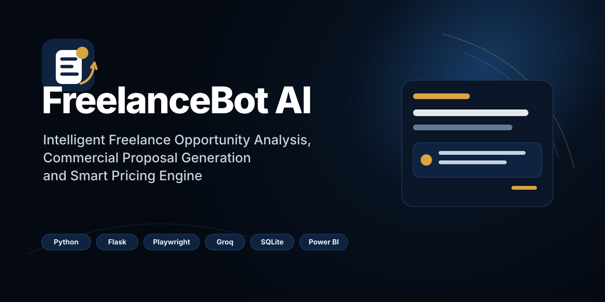
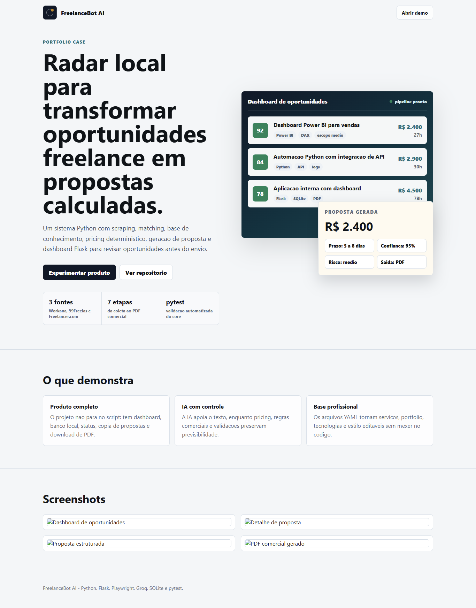
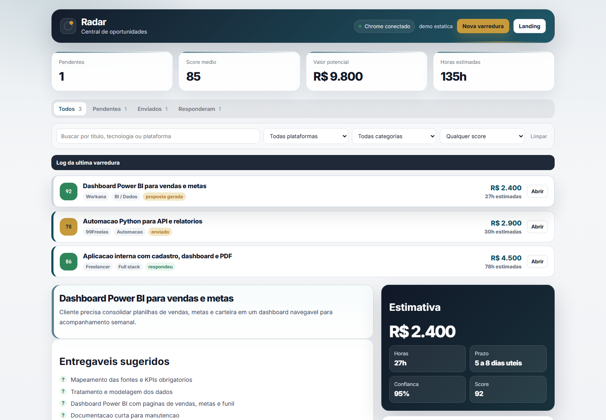
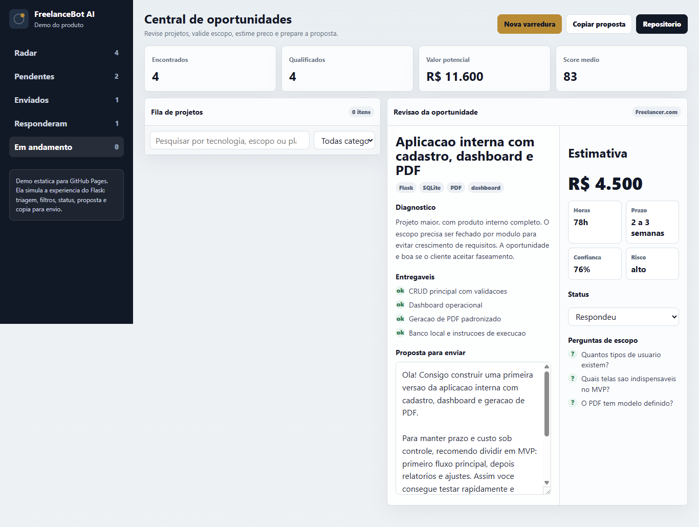
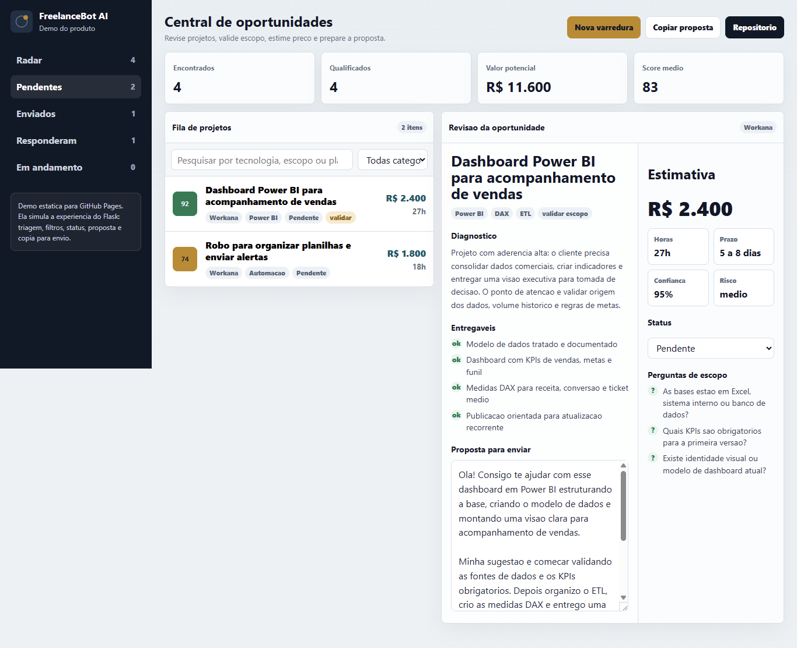

<p align="center">
  
</p>

<p align="center">
  
</p>

<p align="center">
  
  
  
  
  
  
  
</p>

# FreelanceBot AI

Sistema local para encontrar oportunidades freelance, avaliar aderencia ao perfil profissional, calcular preco/prazo e gerar propostas comerciais estruturadas para revisao humana.

O projeto automatiza a triagem e a preparacao da proposta, mas nao envia propostas automaticamente.

**Portfolio publicado**

- Landing: https://vinmedrado.github.io/freelance-bot/
- Demo navegavel: https://vinmedrado.github.io/freelance-bot/demo.html

A demo publicada no GitHub Pages e estatica e roda 100% no navegador, com dados simulados. Ela existe para demonstrar a experiencia do produto sem exigir instalacao. O produto local completo roda com Python, Flask, SQLite, Playwright e integracao Groq.

## Por que existe

Freelancers precisam revisar muitas oportunidades em plataformas como Workana, 99Freelas e Freelancer.com antes de encontrar projetos compativeis. Depois disso, ainda precisam entender o escopo, estimar valor, separar provas profissionais e escrever uma proposta convincente.

O FreelanceBot AI reduz esse trabalho repetitivo com um pipeline local e auditavel.

## O que o sistema faz

1. Coleta oportunidades nas plataformas configuradas.
2. Filtra projetos por aderencia ao perfil profissional.
3. Classifica categoria, complexidade, riscos e perguntas de escopo.
4. Calcula horas, faixa de preco, confianca e premissas.
5. Monta estrategia comercial, proposta curta, proposta completa e PDF.
6. Exibe tudo em um dashboard Flask para revisao, copia, download e controle de status.

A IA via Groq e usada no fluxo de analise textual. As camadas de inteligencia, estrategia, precificacao, proposta estruturada, PDF e dashboard possuem fallback deterministico para visualizacao e revisao.

## Demo de portfolio

A demo em `docs/demo.html` replica a experiencia principal do dashboard com dados demonstrativos:

- fila de oportunidades por status;
- filtros por texto e categoria;
- selecao de projeto com diagnostico e entregaveis;
- estimativa de preco, horas, prazo, confianca e risco;
- proposta editavel e copiavel;
- simulacao de varredura e mudanca de status.

Essa separacao evita depender de login, scraping ou banco local para uma avaliacao rapida do projeto.

## Principais recursos

- Scrapers com Playwright para Workana, 99Freelas e Freelancer.com.
- Matching local por palavras-chave e base profissional.
- Base de conhecimento em YAML para servicos, experiencias, cases, tecnologias, estilo, negociacao e precos.
- Proposal Intelligence deterministica para diagnostico do projeto.
- Commercial Strategy para posicionamento, objecoes, provas e chamada para acao.
- Pricing Engine deterministico com horas, valor/hora, faixa, confianca e premissas.
- Proposal Generator 2.0 com proposta curta, proposta completa e estrutura preparada para PDF.
- PDF Generator 2.0 com layout comercial compacto e fallback legado.
- Dashboard Flask para revisar oportunidades, copiar propostas, baixar PDF e atualizar status.
- Persistencia simples em SQLite.
- Testes automatizados com `pytest`.

## Fluxo

```text
Scrapers
  -> Matching
  -> Proposal Intelligence
  -> Commercial Strategy
  -> Pricing Engine
  -> Proposal Generator
  -> PDF Generator
  -> Dashboard
```

## Arquitetura

| Modulo | Responsabilidade |
| --- | --- |
| `main.py` | Orquestra CLI, scrapers, matching, analise e persistencia. |
| `scrapers/` | Conecta ao Chrome via CDP e coleta projetos das plataformas. |
| `matcher.py` | Calcula aderencia inicial entre projeto e perfil profissional. |
| `knowledge_engine.py` | Carrega YAMLs e seleciona contexto profissional relevante. |
| `proposal_intelligence.py` | Classifica categoria, complexidade, tecnologias, servicos, riscos, cases e perguntas. |
| `commercial_strategy.py` | Define posicionamento comercial, proposta de valor, objecoes, provas e CTA. |
| `pricing_engine.py` | Calcula horas, valor/hora, preco sugerido, faixa, confianca e premissas. |
| `proposal_generator_v2.py` | Gera proposta estruturada, proposta completa e proposta curta. |
| `ai_engine.py` | Integra Groq ao fluxo de geracao, preservando preco e horas deterministicos. |
| `pdf_generator.py` | Gera PDF comercial em memoria com fallback estruturado ou legado. |
| `webapp.py` | Landing, dashboard, APIs, detalhe do projeto, status, PDF e copia de propostas. |
| `db.py` | Persistencia SQLite e migracao minima de colunas existentes. |

Mais detalhes em [docs/architecture.md](docs/architecture.md).

## Como executar

### Requisitos

- Python 3.11+
- Chrome instalado
- Conta/chave Groq para o fluxo com IA

### Instalacao

```bash
git clone <url-do-repositorio>
cd freelance_bot
python -m venv .venv
```

Ative o ambiente:

```bash
# Windows
.venv\Scripts\activate

# macOS/Linux
source .venv/bin/activate
```

Instale dependencias:

```bash
pip install -r requirements.txt
playwright install chrome
```

Configure variaveis:

```bash
copy .env.example .env
```

No macOS/Linux:

```bash
cp .env.example .env
```

Principais variaveis:

```env
GROQ_API_KEY=...
GROQ_MODEL=llama-3.3-70b-versatile
CHROME_CDP_URL=http://127.0.0.1:9222
WEBAPP_HOST=0.0.0.0
WEBAPP_PORT=5050
```

Abra o Chrome com debug remoto antes de rodar os scrapers:

```bash
chrome.exe --remote-debugging-port=9222
```

### Execucao

Rodar varredura:

```bash
python main.py
```

Filtrar plataforma:

```bash
python main.py --plataforma workana
python main.py --plataforma 99freelas
python main.py --plataforma freelancer
```

Ajustar score minimo:

```bash
python main.py --min-score 40
```

Revisar propostas geradas:

```bash
python main.py --revisar
```

Rodar dashboard:

```bash
python webapp.py
```

Acesse:

```text
http://localhost:5050
```

## Screenshots






## Qualidade

Comandos recomendados:

```bash
pytest -q
python validate_setup.py
python -m py_compile ai_engine.py commercial_strategy.py db.py knowledge_engine.py main.py matcher.py pdf_generator.py pricing_engine.py proposal_generator_v2.py proposal_intelligence.py project_validation.py validate_setup.py webapp.py
```

## Documentacao

- [Arquitetura](docs/architecture.md)
- [Decision Log](docs/decision-log.md)
- [Proposal Intelligence](docs/proposal-intelligence.md)
- [Commercial Strategy](docs/commercial-strategy.md)
- [Pricing Engine](docs/pricing-engine.md)
- [Proposal Generator](docs/proposal-generator.md)
- [PDF Generator](docs/pdf-generator.md)
- [Roadmap](ROADMAP.md)
- [Changelog](CHANGELOG.md)
- [Contributing](CONTRIBUTING.md)

## Valor como portfolio

Este e um projeto recomendavel para portfolio porque demonstra automacao, produto, dados, IA aplicada, regras deterministicicas, persistencia, interface web e testes. A landing apresenta o problema e a proposta de valor; a demo permite experimentar o fluxo operacional sem instalar nada.

## Limitacoes e seguranca

- Scrapers dependem da estrutura das plataformas e podem exigir ajustes quando as telas mudam.
- Algumas plataformas exigem login ou sessao de navegador ja autenticada.
- O projeto nao envia propostas automaticamente; a revisao humana faz parte do fluxo.
- Dados locais, banco SQLite, perfis de navegador, artefatos e `.env` ficam fora do versionamento.
- Precos e prazos sao estimativas assistivas, nao garantias comerciais.

## Licenca

Distribuido sob licenca MIT. Veja [LICENSE](LICENSE).
